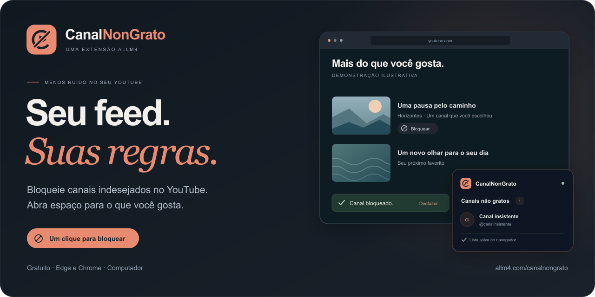

  

<h1 align="center">CanalNonGrato</h1>

  Menos canais indesejados. <strong>Mais espaço para o que você gosta.</strong> 
  Gratuito, em português, para Microsoft Edge e Google Chrome no computador.

  <strong><a href="https://allm4.com/canalnongrato/">Conhecer e experimentar</a></strong>
  &nbsp; · &nbsp;
  <strong><a href="https://github.com/Benfic4rthur/CanalNonGrato/releases/latest">Baixar a última versão</a></strong>
  &nbsp; · &nbsp;
  <a href="#instalação">Como instalar</a>

---

## Seu feed, suas regras

Viu um canal que não quer mais acompanhar? Clique em **Bloquear**. O CanalNonGrato guarda a sua escolha e filtra os conteúdos publicados por ele, inclusive nas pesquisas, nos Shorts e nas recomendações ao lado do vídeo.

| Recurso | Como funciona |
| --- | --- |
| **Bloqueio onde você vê vídeos** | Filtra a página inicial, recomendações, pesquisas, Shorts, playlists e publicações identificadas como sendo do canal. |
| **Um clique no vídeo aberto** | O botão **Bloquear canal** fica ao lado de Inscrever-se. Nas listas, use **Bloquear** junto ao autor. |
| **Sua lista, organizada** | Nome e foto do canal, busca e desbloqueio pelo ícone da extensão ou pelo painel completo. |
| **Inscrições respeitadas** | Oculta os botões de bloqueio nos canais identificados como inscritos pelo próprio YouTube. |
| **Identificação do canal** | Quando disponível, usa o ID imutável do YouTube para manter o bloqueio mesmo se o nome ou o @ mudar. |
| **Backup das suas escolhas** | Exporte e importe a lista em JSON para guardar uma cópia ou levá-la a outro navegador. |
| **Leve no navegador** | Sem bibliotecas de execução na extensão instalada, sem servidor próprio e sem verificações periódicas. |

O bloqueio identifica **quem publicou o conteúdo**. Vídeos de outros canais que mencionam a mesma pessoa ou assunto podem continuar aparecendo. [Veja a cobertura e os limites do filtro](docs/guia.md#onde-o-filtro-atua).

## Instalação

**[Baixe o ZIP na última release](https://github.com/Benfic4rthur/CanalNonGrato/releases/latest)**, extraia e guarde a pasta em um lugar fixo. O mesmo pacote serve para Edge e Chrome.

| Microsoft Edge | Google Chrome |
| --- | --- |
| Abra `edge://extensions` | Abra `chrome://extensions` |
| Ative **Modo do desenvolvedor** | Ative **Modo do desenvolvedor** |
| Clique em **Carregar sem pacote** ou **Carregar sem compactação** | Clique em **Carregar sem compactação** |

1. Selecione **a pasta extraída que contém `manifest.json`**. Se você clonou o repositório, selecione a pasta [`extension`](extension/).
2. Fixe o ícone do CanalNonGrato no menu de extensões e recarregue as abas do YouTube.
3. Use **Bloquear** nos vídeos ou abra o ícone da extensão para adicionar um **@**, link ou nome exato.

A distribuição é por ZIP, fora das lojas dos navegadores. **Não é necessário instalar Node.js, dependências ou rodar um servidor para usar.** As atualizações também são manuais: substitua os arquivos na pasta instalada, clique em **Recarregar** no cartão da extensão e recarregue o YouTube.

Instruções oficiais: [Microsoft Edge](https://learn.microsoft.com/en-us/microsoft-edge/extensions/getting-started/extension-sideloading) · [Google Chrome](https://developer.chrome.com/docs/extensions/get-started/tutorial/hello-world#load-unpacked).

## Mudou de ideia? Você pode desbloquear

Abra o ícone do CanalNonGrato, procure o canal na lista e clique em **Desbloquear**. As abas abertas recebem a mudança automaticamente. **Abrir painel** mostra a lista em uma página maior; **Exportar** e **Importar** fazem backup das suas escolhas.

Prefira o botão no vídeo, um **@** ou um link para identificar o canal com precisão. Nomes digitados sozinhos são comparados por nome exato; canais diferentes com o mesmo nome também podem ser ocultados. [Leia o guia de uso](docs/guia.md).

## Leveza e privacidade

- A extensão instalada usa JavaScript, CSS e ícones locais, sem dependências de execução, analytics ou servidor próprio.
- A lista fica no perfil do navegador, em `chrome.storage.local`. Não é sincronizada com a conta do YouTube.
- Usa as permissões `storage` e `scripting`, com acesso limitado aos domínios do YouTube declarados no manifesto. Não pede acesso geral ao histórico ou aos cookies.
- Metadados públicos do YouTube ajudam a identificar os canais. As fotos podem ser carregadas dos servidores do YouTube/Google; não há rastreamento próprio.
- O processo de fundo dorme quando ocioso. A filtragem acompanha alterações da página, agrupa o trabalho e usa cache para evitar consultas repetidas.

O filtro atua no YouTube deste navegador. Mudanças na interface do YouTube podem exigir atualizações da extensão. Exporte um backup antes de desinstalar ou apagar o perfil.

Consulte o [manifesto](extension/manifest.json), o [código da extensão](extension/) e o [guia de funcionamento](docs/guia.md).

## Para quem quer olhar por dentro

| Diretório | Conteúdo |
| --- | --- |
| [`extension/`](extension/) | Extensão instalável, interface em português e ícone oficial. |
| [`tests/`](tests/) | Testes de identidades, filtragem, conteúdo dinâmico, backups e ociosidade. |
| [`scripts/`](scripts/) | Build, geração dos ícones, empacotamento e verificação no YouTube real. |
| [`docs/`](docs/) | Guias de uso, desenvolvimento e publicação de versões. |

**[Desenvolver e testar](docs/desenvolvimento.md)** · **[Publicar uma versão](docs/publicacao.md)** · **[Relatar um problema](https://github.com/Benfic4rthur/CanalNonGrato/issues)**

As releases alimentam os downloads do site automaticamente: versão, tamanho e pacote pertencem à mesma release estável. Em caso de falha na consulta, o site leva à página da última release.

---

  Feito pela <a href="https://allm4.com/">ALLM4</a>. 
  Projeto independente, sem vínculo com YouTube, Google ou Microsoft.

